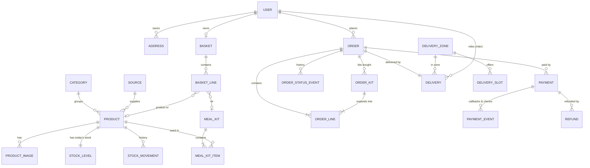
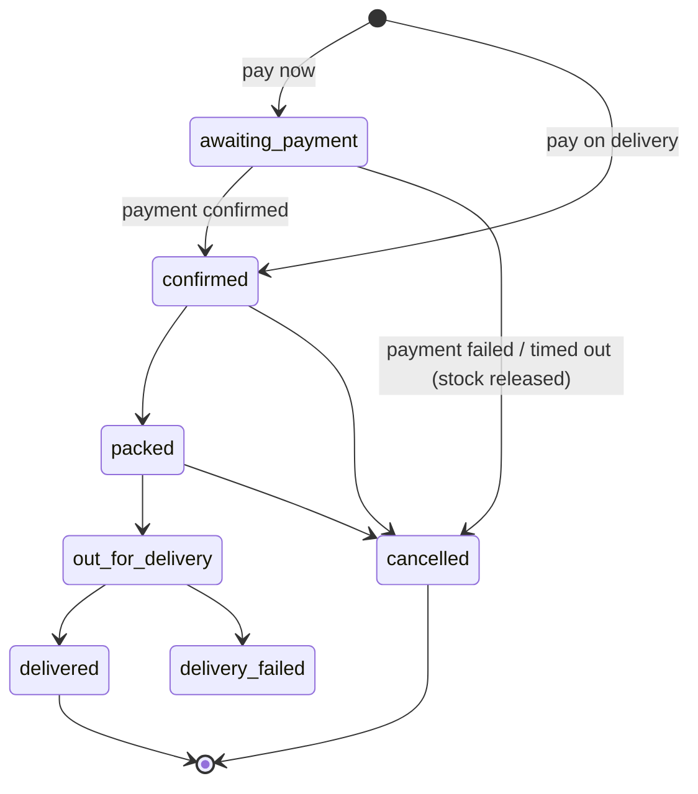

# Backend Analysis — First Assignment (Proposed)

_Author: Backend Specialist conversation · Date: 2026-11-26 · Status: **Accepted with amendments, 2026-11-26** (owner approved the architecture review; see the next section, ADR-0010, ADR-0011, ADR-0012)_

## Approved amendments from the architecture review (2026-11-26)

These override anything later in this document that disagrees. Sources: `docs/architecture/TECHNICAL_ARCHITECTURE_PROPOSAL_2026-11.md` (approved), ADR-0010, ADR-0011, ADR-0012.

| # | Amendment | Affects |
|---|---|---|
| B-1 | **Accepted:** domain model (§2), database rules (§3), 10 Django apps (§1.2), integer KES, API conventions (§4.1), guest basket via Django session (§4.3), own idempotency records and thin provider clients | §1–§5 |
| B-2 | **Single status path:** rider/staff actions change `Delivery`; `orders.services` updates `Order.status` in the same transaction; tests assert they agree | §2.2 orders/delivery |
| B-3 | **Payments at launch: Pochi la Biashara with manual verification** (`ManualPochiGateway`). Payment fields add: `method` = `pochi_manual` (also `daraja_stk` sandbox-only, `pesapal` future), `mpesa_code` (unique when set), `payer_phone`, `submitted_at`, `verified_by`, `verified_at`, `rejection_reason`. Statuses: `awaiting_verification`, `paid`, `rejected`, `needs_review` (plus the STK statuses for the sandbox adapter). Staff verification queue and reconciliation in Django admin; every action audit-logged | §2.2 payments, §5 |
| B-4 | **Daraja is sandbox only** (development). The §5.2 STK controls apply to the sandbox adapter and to any future automatic provider. **Pesapal** is a future update with its own ADR | §5 |
| B-5 | **Payment-timing switch:** `StoreSettings.allow_pay_now` and `allow_pay_on_delivery` (database CHECK: at least one true). `Order.payment_timing` (`pay_now` / `pay_on_delivery`) is a snapshot; switching affects new orders only | §2.2 store, orders |
| B-6 | **Endpoints for Pochi:** `POST /orders/{reference}/payments` submits `{mpesa_code, payer_phone}` (idempotent); `GET .../payments/latest` returns the status; rider `POST /rider/deliveries/{id}/payment-code` records the code at the door. The Daraja callback endpoint exists only in development/sandbox settings | §4.2 |
| B-7 | **Stock updated throughout the day** (owner, Q5): staff adjust in admin at any time (`adjustment` movements); no automatic daily reset or carry-over. Prices also change during the day: audit-logged; checkout re-prices (409) | §2.2 inventory, §2.3 |
| B-8 | **Coverage:** Nairobi County and Kiambu, Kajiado, Machakos. Zones, fast/slot mode, slots and cut-offs configured in admin | §2.2 delivery |
| B-9 | **Login codes sent directly** via the allauth adapter (short timeout, Turnstile, throttles); order/delivery SMS through the worker. **Scheduled jobs** via host cron → management commands | §5, §6 |
| B-10 | **Libraries trimmed (ADR-0010):** Africa's Talking via REST + httpx (no SDK); respx only; django-environ only; auditlog not on history tables; error handler: one of drf-standardized-errors or custom | §6 |
| B-11 | Retention periods (§3.5): accountant check deferred to a future update by the owner; the conservative proposed periods apply meanwhile | §3.5 |
| B-12 | **Google Maps (ADR-0013):** `GeoService` in the delivery app wraps Geocoding and Routes (httpx, server key, respx in tests). Called only for quotes/checkout, with timeouts and a fallback (if Google fails: zone chosen from the list, slots offered) | §2.2 delivery, §6 |
| B-13 | **Address and order location fields:** `Address` and the order address snapshot gain `latitude`, `longitude` (customer-confirmed pin), `google_place_id`, `pin_confirmed_at`, `county`. Only confirmed pins and place IDs are kept long-term; other Google results follow the terms' caching period | §2.2 accounts, orders |
| B-14 | **Fast-zone rule:** `StoreSettings.dispatch_point` (provisional Nairobi CBD) and `fast_radius_km` (default 42). Pin within radius → fast (ETA from Routes); else county in {Nairobi, Kiambu, Kajiado, Machakos} → slots; else refused. `DeliveryZone` stays for fees/naming; zone mode can be overridden per zone by staff | §2.2 delivery, §2.3 rule 4 |
| B-15 | **Delivery partner:** new `DeliveryPartner` (name, contact, active); `Delivery.partner` and optional `partner_reference`; partner riders are users in the Rider group linked to the partner. Partner API integration is a future option | §2.2 delivery, §4.2 rider |
| B-16 | **New endpoint:** `POST /delivery/quote` with `{latitude, longitude, place_id}` → `{mode, zone, fee_kes, eta_minutes or slots, outside_area}`; `PUT /basket/delivery-location` stores the pin on the basket for the quote. Staff: **2 admin users** at launch, both with MFA | §4.2 |

This is the backend's first assignment: an analysis done **before any code is written**. Nothing here is implemented. Items marked **Proposed** need approval before they are acted on. Items marked **Decided** repeat earlier owner decisions so this document can be read on its own.

## How to read this document

- §1 lists the backend modules and proposes grouping them into fewer Django apps.
- §2 is the domain model: the business "things" and how they relate. §3 adds database rules (constraints, indexes, transactions, retention).
- §4 is the preliminary API list the frontend will call. §5 covers payments in detail, because they carry the most risk.
- §6 is the research: supporting libraries, and what to reuse rather than build.
- §7 lists the decisions needed from you (the owner) and the Project Architect.

**Words used:**
- **Model**: a Django class that becomes a database table.
- **Snapshot**: copying a value (such as a price) onto an order so later changes don't rewrite history.
- **Idempotent**: doing the same request twice has the same effect as doing it once. This matters for payments and order creation, where networks retry.

---

## 0. Inputs and limits

| Input | Used for |
|---|---|
| `docs/requirements/REQUIREMENTS_BASELINE.md` (draft v0.1) | Functional and non-functional requirements (FR-/NFR- IDs below) |
| `docs/architecture/SYSTEM_ARCHITECTURE.md` | Module boundaries, key flows, security allocation |
| ADR-0002, 0003, 0004, 0006, 0008 (Accepted); ADR-0005, 0007 (Proposed) | Stack: Django 6.x + DRF, PostgreSQL, REST + OpenAPI, Django admin, Daraja sandbox behind `PaymentGateway` |
| `frontend/documentation/architecture/FRONTEND_ANALYSIS_2026-11.md` §8 (Accepted) | The frontend's data needs, which this document answers |
| `PROJECT_STATE/02_DECISIONS_AND_CHANGES.md` D-015 (server basket), D-017 (fast/slot zones), D-018 (Beverages) | Fixed decisions |
| `docs/research/TECHNOLOGY_RESEARCH_2026-11.md` | Earlier research; not repeated here |

**Filesystem check (2026-11-26):** `backend/` contains only empty folders (`.gitkeep`) and READMEs. `shared/contracts/` is empty. There is no backend code, no dependency file and no database. (Fact)

**Limits:**
- Open business questions in `REQUIREMENTS_BASELINE.md` §5 (pay timing, stock model, delivery coverage) affect parts of the design. Where they do, this document says so and gives a design that works for every likely answer.
- Package versions are noted as of November 2026. They must be re-checked when each package is installed in Phase 3.

---

## 1. Backend domain modules

### 1.1 What each module owns

| Module | Owns | Main requirements |
|---|---|---|
| Authentication | Phone + one-time-code sign-in, sessions, staff MFA (django-allauth; ADR-0005 Proposed) | FR-40, NFR-05 |
| Users / customers | User account, roles (customer, staff, rider, admin), saved addresses, data-deletion requests | FR-41, FR-43, NFR-07 |
| Catalogue (categories, products, farmers, suppliers) | Categories, products, prices, discounts, images, farms and suppliers | FR-01–07, FR-60 |
| Meal kits | Kit definitions and kit prices | FR-10, FR-11 |
| Inventory | Today's stock per product, stock reservations, stock history | FR-04, FR-61 |
| Basket (cart) | Server basket for every visitor, including guests (D-015) | FR-20, FR-21 |
| Checkout / orders | Turning a basket into an order, order lines, status history | FR-22–24, FR-42, FR-51 |
| Payments | Payment attempts, callbacks, confirmation, refunds, `PaymentGateway` interface | FR-30–34, NFR-06 |
| Delivery | Zones (fast or slots), slots and cut-offs, rider assignment, delivery status | FR-50–52 |
| Notifications | SMS and email sending, message log | FR-24, FR-70 |
| Reviews | Later (FR-71, priority L); not modelled now | — |
| Administration | Django admin set-up, audit log, store settings, reports | FR-60–64 |

### 1.2 Proposed grouping into Django apps

The Phase 1 skeleton has **16** module folders under `backend/src/modules/`. In Django, each module becomes an "app" with its own models and migrations. Very small apps that always change together add migration and import overhead for no benefit.

**Proposed:** 10 Django apps, grouped by what changes together.

| Django app (Proposed) | Replaces skeleton folders | Why grouped |
|---|---|---|
| `core` | — (new) | Shared code only: money helpers, phone normalising, idempotency records, error format, base models |
| `accounts` | authentication, users, customers | One user model; allauth config; addresses; deletion requests |
| `catalogue` | categories, products, farmers, suppliers (+ meal kits) | Read together on every storefront page; edited together in admin |
| `inventory` | inventory | Concurrency-critical; kept separate so its rules stay small and well tested |
| `basket` | cart | Separate lifecycle (anonymous, short-lived) |
| `orders` | checkout, orders | Checkout's only output is an order |
| `payments` | payments | Highest-risk area; isolated behind `PaymentGateway` |
| `delivery` | delivery | Zones, slots, riders |
| `notifications` | notifications | Outbound messages via the task worker |
| `store` | administration | Store settings, audit log set-up, reports, admin customisation |

`reviews` stays an empty placeholder until FR-71 is scheduled.

This works together with the Architect's earlier proposal (SYSTEM_ARCHITECTURE §3) to drop the top-level `domain/`, `application/`, `services/` and `repositories/` layers. Each app gets `models.py`, `services.py` (business rules), `api/` (serializers and views), `admin.py`, `tasks.py` where needed, and `tests/`. **Folder changes need owner approval at the Phase 3 scaffold** and would be recorded in an ADR. No folders have been changed.

### 1.3 Rules between modules

- A module changes another module's data only through that module's `services.py` functions (for example, `orders` calls `inventory.services.reserve(...)`; it never edits stock rows directly).
- Reading across modules with Django foreign keys is fine (an order line points at a product).
- The browser is untrusted: prices, stock, delivery fees, totals and payment status are always calculated on the server (SYSTEM_ARCHITECTURE §2).

---

## 2. Domain model (Proposed)

### 2.1 Diagram



### 2.2 Entities

Money is stored as **whole Kenyan shillings in integer columns** (Proposed; see §3.1). Names ending `_kes` are amounts in KES.

**accounts**

| Entity | Key fields | Notes |
|---|---|---|
| User (custom) | id, phone (E.164, unique), phone_verified, email (optional, unique when set), full_name, is_staff, is_active, date_joined | **A custom user model must be created before the first migration.** Django cannot easily switch later. Roles via Django groups: Customer, Staff, Rider, Admin |
| Address | user, label ("Home"), zone, area/estate, building/house, landmark, instructions, optional latitude/longitude, is_default | FR-41 (S). Orders copy the address, so editing one later doesn't change past orders |
| DeletionRequest | user, status (requested/processing/completed/rejected), requested_at, completed_at, staff note | FR-43. See retention §3.5 |

One-time codes are handled by django-allauth and are **not stored in our own tables**. (allauth's internals: to confirm at implementation.)

**catalogue**

| Entity | Key fields | Notes |
|---|---|---|
| Category | slug (unique, never changed once live), name_en, name_sw, sort_order, is_active | Seed from `docs/business-requirements/PRODUCT_CATEGORIES.md`; tabs are data-driven (D-018) |
| Source | slug, kind (`farm` / `supplier`), name, county/location, story, contact (staff-only), is_active | **Proposed:** one table for farms and suppliers, because the storefront treats them the same way ("Kale from Kinangop"). Contact details are never exposed by the API |
| Product | slug, name_en, name_sw, description, category, source, origin_label (e.g. "Kinangop"), unit_label ("1kg", "bunch"), price_kes, compare_at_price_kes (was-price, optional), is_active, search fields | Discount % is **calculated**, not stored. `origin_label` allows a product without a profiled farm |
| ProductImage | product, file (in object storage), alt_text, sort_order | Alt text required (WCAG) |
| MealKit | slug, name, description, price_kes, is_active, image | FR-10 |
| MealKitItem | meal_kit, product, quantity | Separate total = Σ product price × quantity, **calculated** live, so the saving is always correct |

**inventory**

| Entity | Key fields | Notes |
|---|---|---|
| StockLevel | product (one-to-one), quantity_available, low_stock_threshold, updated_at | Today's sellable quantity. Database rule: never below 0 |
| StockMovement | product, change (+/−), reason (`daily_set`, `order_reserved`, `order_cancelled`, `adjustment`, `returned`), order (optional), actor, created_at | Append-only history. Answers "why is stock 3?" and supports FR-64 |

Stock is reserved (subtracted) **when the order is placed**, not when an item is added to the basket. Baskets never hold stock, so abandoned baskets can't block other shoppers. The basket shows "only 9 left" as information only and re-checks at checkout.

**Decided (B-7): stock is updated throughout the day.** Original note: owner question 5 (stock set once each morning, or updated during the day). The design works for both. Staff either use a "set today's stock" action (`daily_set` movement) or adjust during the day (`adjustment`). Whether unsold stock carries over to the next day is a business rule to confirm.

**basket**

| Entity | Key fields | Notes |
|---|---|---|
| Basket | id (UUID), user (optional), delivery_zone (optional, used for the fee estimate), status (`active`/`merged`/`converted`), created_at, updated_at | Guests: the basket id is kept in the visitor's Django session (§4.3) |
| BasketLine | basket, product **or** meal_kit (exactly one), quantity, added_at | Database rule enforces "exactly one". No prices stored; prices are always read live |

**orders**

| Entity | Key fields | Notes |
|---|---|---|
| Order | reference (unguessable, e.g. `SF-7KQ2M9XA`), user, status, payment_method (`mpesa_now` / `mpesa_on_delivery`), subtotal_kes, delivery_fee_kes, total_kes, contact_name, contact_phone, address snapshot fields, delivery_zone, slot snapshot (date, start, end) or ETA snapshot, customer_note, placed_at, idempotency key | All amounts and the address are snapshots |
| OrderKit | order, meal_kit, name snapshot, kit_price_kes, quantity | Records that a kit was bought at the kit price |
| OrderLine | order, product, order_kit (optional), name_en/name_sw/unit_label snapshots, unit_price_kes, quantity, line_total_kes, rejected_quantity | Kit items are stored as lines linked to their OrderKit. Each kit's price is **shared out across its items in proportion to their normal prices**, so a refund for one rejected kit item can be calculated (FR-33) |
| OrderStatusEvent | order, from_status, to_status, actor (user/system), note, created_at | Drives the tracking timeline (FR-51) and the audit trail |

**Order statuses (Proposed):**



Payment status is tracked **separately** on the order (`unpaid`, `paid`, `partially_refunded`, `refunded`), so "delivered but unpaid" can be seen and chased. If owner question 3 is "pay on delivery only", `awaiting_payment` is simply never used.

**payments**

| Entity | Key fields | Notes |
|---|---|---|
| Payment | id, order, provider (`daraja`, later others), method (`stk_push`), amount_kes, phone (E.164), status (`initiated`, `pending`, `paid`, `failed`, `cancelled`, `timed_out`), merchant_request_id, checkout_request_id (unique), provider_receipt (M-Pesa receipt, unique when set), result_code, result_description, initiated_by (customer/rider/staff), created_at, confirmed_at | One row per STK Push attempt. An order can have several attempts; at most one may be `paid` (database rule) |
| PaymentEvent | payment (optional), kind (`callback`, `status_query`, `initiation_response`), raw_payload (JSON), source_ip, received_at, outcome | Append-only log of everything Safaricom sent or answered (FR-32, NFR-13). Kept even when unmatched |
| Refund | payment, order_line (optional), amount_kes, reason, status, approved_by, provider reference, created_at | FR-33 (S). Model now; flow later |

**Never stored:** M-Pesa PIN, one-time codes, Daraja consumer secret or passkey (environment variables only).

**delivery**

| Entity | Key fields | Notes |
|---|---|---|
| DeliveryZone | slug, name, mode (`fast` / `slots`, D-017), fee_kes, free_delivery_threshold_kes (optional; otherwise the store default), eta_min_minutes, eta_max_minutes (fast zones), is_active, sort_order | FR-50 |
| DeliverySlot | zone, weekday(s), start_time, end_time, cutoff_time (e.g. 14:00 for the evening slot), capacity (orders), is_active | A repeating weekly template. Available slots for a date = template minus orders already booked |
| SlotClosure (S) | zone, date, reason | Holidays, bad weather |
| Delivery | order (one-to-one), zone, slot_date/start/end or eta, rider (user in Rider group), status (`unassigned`, `assigned`, `out_for_delivery`, `arrived`, `delivered`, `failed`), assigned_at, arrived_at, delivered_at, failure_reason | FR-51, FR-52 |

**notifications**

| Entity | Key fields | Notes |
|---|---|---|
| Notification | recipient user (optional), phone/email, channel (`sms`/`email`), template key, related order, status (`queued`, `sent`, `failed`), provider_message_id, error, attempts, created_at, sent_at | Message **content is not stored** for login codes. For order messages, store the template key and variables, not free text |

**store / core**

| Entity | Key fields | Notes |
|---|---|---|
| StoreSettings (single row) | default free-delivery threshold, opening hours, support phone, WhatsApp, M-Pesa till/paybill shown on the site, email | Frontend §8 "store settings"; avoids hard-coding KES 1,500 (D-7) |
| IdempotencyRecord | key, scope (user or basket), endpoint, request fingerprint, response status/body, created_at, expires_at | Stops double orders and double STK Pushes when a request is retried (§4.4) |
| Audit log | (from an audit package, §6) actor, model, object, field changes, timestamp | FR-64: staff changes to prices, stock, orders |

### 2.3 Key business rules (to become tests)

1. A product can be added to the basket only if it is active; the quantity can't exceed today's stock (checked again at checkout).
2. Adding a meal kit checks stock for **every** item in it, multiplied by the kit quantity, together with the same products already in the basket (FR-11).
3. Delivery fee = zone fee, or 0 when subtotal ≥ threshold (zone threshold, else store default).
4. Slot zones: a slot can be chosen only before its cut-off on that day (Africa/Nairobi time) and while capacity remains. Fast zones: ETA is shown, and only during opening hours.
5. Placing an order: re-price everything on the server. If the total differs from the total the customer saw, refuse with a "prices changed" error (HTTP 409) rather than charge a different amount.
6. An order is marked paid **only** after the payment is confirmed with Safaricom (§5). A duplicate callback changes nothing.
7. Cancelling an unpaid order releases its reserved stock (a `order_cancelled` movement).

---

## 3. Database requirements

### 3.1 Money and time

- **Money: whole shillings in integer columns** (Proposed). KES prices on the design are whole numbers, and M-Pesa STK Push amounts are whole numbers. Integers avoid rounding errors. If cents are ever needed, a migration to `DECIMAL(12,2)` is straightforward.
- **Time:** all timestamps stored in UTC (`USE_TZ = True`), shown in Africa/Nairobi. Cut-off rules are calculated in Africa/Nairobi time.
- **Phone numbers:** stored in E.164 (`+2547…`, `+2541…`), validated with the `phonenumbers` library.

### 3.2 Constraints (enforced by PostgreSQL, not only by code)

| Rule | Constraint |
|---|---|
| Stock can't go negative | `CHECK (quantity_available >= 0)` on StockLevel |
| Prices positive; was-price above price | `CHECK (price_kes > 0)`, `CHECK (compare_at_price_kes IS NULL OR compare_at_price_kes > price_kes)` |
| Basket line is a product or a kit, not both | `CHECK` (exactly one of product_id, meal_kit_id) |
| No duplicate product lines in a basket | Unique (basket, product) and (basket, meal_kit), partial where not null |
| One paid payment per order | Partial unique index on payment(order) where status = 'paid' |
| Callback can't be applied twice | Unique `checkout_request_id`; unique `provider_receipt` where not null |
| Unique slugs, order references, user phones | Unique indexes |
| Quantities positive | `CHECK (quantity > 0)` on basket, kit and order lines |

The database rules are a safety net. Even if application code had a bug, stock could not be oversold and a payment could not be credited twice.

### 3.3 Indexes (initial)

| Table | Index | Supports |
|---|---|---|
| Product | (category, is_active, sort); GIN trigram on name_en and name_sw; full-text vector | Shop page, typo-tolerant search (FR-05, ADR-0003 pg_trgm) |
| Order | (user, placed_at desc); reference unique; (status, placed_at) | History, staff order list |
| Payment | checkout_request_id unique; (order, created_at); (status, created_at) | Callback lookup, reconciliation |
| Delivery | (rider, status); (zone, slot_date) | Rider list, slot capacity |
| StockMovement | (product, created_at) | Stock history |
| Basket | (updated_at) where status = active | Expiry clean-up |

More indexes are added only when measured queries need them (NFR-02).

### 3.4 Transactions and concurrency

| Operation | How it stays correct |
|---|---|
| Place order | One database transaction: lock the needed StockLevel rows (`SELECT … FOR UPDATE`, always in product-id order to avoid deadlocks), check, subtract, write movements, create order and lines, mark basket converted, save idempotency record. All or nothing |
| Payment callback | Lock the Payment row; if already final, record the event and stop; otherwise confirm with Safaricom (§5) and update payment + order in one transaction |
| Slot booking | Lock the slot's capacity check within the order transaction so the last place can't be taken twice |
| Staff stock edits | Go through `inventory.services` so a movement is always written |

Testing requirement: a concurrency test where two orders race for the last item must show exactly one succeeds (backend testing role brief §9).

### 3.5 Data retention (Proposed; confirm with an accountant / legal adviser)

| Data | Keep for | Reason |
|---|---|---|
| Orders, order lines, payments, payment events, refunds | **7 years (Proposed)** | Kenyan tax records must be kept for a minimum period (commonly cited as 5 years under the Tax Procedures Act; confirm). 7 years gives a margin. **Not legal advice** |
| Customer account after a deletion request | Personal fields anonymised (name, email, addresses removed; phone replaced by a one-way hash) within 30 days; orders kept with anonymised contact | FR-43 and Kenya Data Protection Act, 2019, balanced against tax retention |
| Guest/abandoned baskets | Deleted after 30 days without activity | Minimal data |
| Notification log | 12 months | Support and debugging |
| Raw payment events | Same as payments | Audit trail |
| Audit log | 7 years | FR-64 |
| Application logs | 30–90 days, no full phone numbers or tokens | NFR-07 |

### 3.6 Migrations and seed data

- Django migrations, committed to git, generated per app. Never edited after they have been applied in a shared environment.
- Seed data: categories and the 15 design products from `PRODUCT_CATEGORIES.md`, sample zones/slots, one **clearly marked** placeholder testimonial (D-016). Seeds are for development and staging only. Prices in seeds are labelled as samples.

---

## 4. Preliminary API inventory (Proposed)

### 4.1 Conventions (Proposed, to confirm with Frontend and Architect)

| Topic | Proposal |
|---|---|
| Base path | `/api/v1/` (ADR-0004). Authentication endpoints are allauth's own: `/_allauth/browser/v1/…` |
| Format | JSON; field names in `snake_case` (DRF default; the generated TypeScript types will use the same names) |
| Identifiers in URLs | Slugs for public catalogue items; unguessable references for orders; UUIDs elsewhere. Never sequential database IDs |
| Pagination | Page-number: `?page=2&page_size=24` (max 100), returning `count`, `next`, `previous`, `results`. Simple for a catalogue of this size |
| Filtering/search | `?category=mboga&q=sukuma&ordering=price` |
| Errors | RFC 9457 "problem details" (`application/problem+json`) with an `errors` list for field problems, as the frontend proposed (§6 for tooling) |
| Money | Integer KES, e.g. `"price_kes": 120`; the frontend formats it as "KES 120" |
| Auth | Session cookie (HttpOnly, Secure, SameSite=Lax) + CSRF token header for changes; frontend and API on the same parent domain (ADR-0005 Proposed) |
| Rate limits | DRF throttles per IP and per user; tighter on sign-in codes, order creation and payment requests |
| Idempotency | `Idempotency-Key` header required on `POST /orders` and payment-request endpoints |
| Versioning | Breaking changes need `/api/v2/` and Architect approval (ADR-0004) |

### 4.2 Endpoints

**Public catalogue and store**

| Method & path | Purpose | Pri |
|---|---|---|
| GET `/store-settings` | Free-delivery threshold, hours, contacts, till | M |
| GET `/categories` | Category tabs (en/sw names, order) | M |
| GET `/products` | List: filter by category, `q` search, pagination. Each item: slug, names, unit, price, was-price, discount %, stock left today, low-stock flag, images, category, origin | M |
| GET `/products/{slug}` | Detail + farm/supplier summary | S |
| GET `/meal-kits` · GET `/meal-kits/{slug}` | Kits with items, kit price, separate total, saving, availability | M |
| GET `/sources/{slug}` | Farm / supplier profile | S |
| GET `/delivery-zones` | Zones: name, mode (fast/slots), fee, threshold | M |
| GET `/delivery-zones/{slug}/availability?date=` | Fast: current ETA or "closed". Slots: slots with cut-off and whether still available | M |
| GET `/health` | Liveness check for hosting (no data) | M |

**Basket (D-015: server basket for everyone)**

| Method & path | Purpose | Pri |
|---|---|---|
| GET `/basket` | Current basket with **validated quote**: lines (unit price, line total), subtotal, delivery fee for the chosen zone, amount to free delivery, total, and a `problems` list (price changed, out of stock, only N left) | M |
| POST `/basket/lines` | Add `{product_slug or meal_kit_slug, quantity}`; merges with an existing line | M |
| PATCH `/basket/lines/{id}` | Change quantity | M |
| DELETE `/basket/lines/{id}` | Remove line | M |
| PUT `/basket/delivery-zone` | Choose the zone for the fee estimate | M |
| DELETE `/basket` | Empty the basket | S |

**Orders and checkout**

| Method & path | Purpose | Pri |
|---|---|---|
| POST `/orders` | Place an order from the basket: zone, slot (or fast), address fields or saved-address id, contact name/phone, payment method, note, `expected_total_kes`. Header `Idempotency-Key`. Returns 201 with order; 409 if prices/stock changed; 422 for validation | M |
| GET `/orders` | My orders, newest first | S |
| GET `/orders/{reference}` | Order detail, status timeline, delivery info, payment status | M |
| POST `/orders/{reference}/cancel` | Cancel while still allowed | S |
| POST `/orders/{reference}/reorder` | Copy available items into the basket | S |

**Payments**

| Method & path | Purpose | Pri |
|---|---|---|
| POST `/orders/{reference}/payments` | Customer starts an STK Push (pay now, or retry). `Idempotency-Key` header. Phone defaults to the order's phone | M |
| GET `/orders/{reference}/payments/latest` | Status for the waiting screen: `pending`, `paid`, `failed`, `cancelled`, `timed_out` + friendly message | M |
| POST `/payments/daraja/callback/{secret}` | **Safaricom only.** Not part of the frontend contract; excluded from the generated frontend client | M |

**Account (signed-in customer)**

| Method & path | Purpose | Pri |
|---|---|---|
| GET / PATCH `/me` | Profile (name, optional email) | M |
| GET / POST `/me/addresses`, PATCH / DELETE `/me/addresses/{id}` | Saved addresses | S |
| POST `/me/deletion-request` · GET `/me/deletion-request` | Request account/data deletion and see its status | M |
| GET `/me/data-export` | Download my data | S |

**Rider (Rider role only)**

| Method & path | Purpose | Pri |
|---|---|---|
| GET `/rider/deliveries?status=` | My assigned deliveries: address, landmark, customer phone, items, amount due | M |
| GET `/rider/deliveries/{id}` | Detail | M |
| POST `/rider/deliveries/{id}/arrived` | Mark arrived; for pay-on-delivery orders, starts the STK Push (idempotent) | M |
| POST `/rider/deliveries/{id}/payment-request` | Re-send the M-Pesa prompt | M |
| POST `/rider/deliveries/{id}/delivered` | Confirm delivery, optional rejected items (FR-33) | M |
| POST `/rider/deliveries/{id}/failed` | Record failed delivery with reason | M |

**Authentication (django-allauth headless, browser client; depends on ADR-0005)**

allauth provides these; we configure them rather than build them. Examples: `GET /_allauth/browser/v1/config`, `GET /_allauth/browser/v1/auth/session`, `POST …/auth/code/request` (send code to phone), `POST …/auth/code/confirm`, `DELETE …/auth/session` (sign out). allauth's headless mode uses Django session cookies with CSRF protection for browser clients.

**Staff:** no staff REST API at launch. Staff use Django admin (ADR-0008).

### 4.3 Basket details to agree with Frontend (D-015)

| Question | Proposal | Why |
|---|---|---|
| How is a guest's basket identified? | Store the basket id in the visitor's **Django session** (the same HttpOnly session cookie allauth uses). No extra cookie | One cookie, already secured; Django keeps session data when the visitor signs in |
| CSRF | All basket changes send the CSRF token (Django's standard method) | Basket changes are state-changing requests |
| Merge at sign-in | If the customer already has a basket from a previous visit, merge: add guest lines into it, quantities capped at available stock; guest basket marked `merged` | Customers don't lose items |
| Expiry | Guest baskets deleted after 30 days of no activity (daily task) | Data minimisation |
| Price changes | Basket shows live prices; `problems` lists what changed since added | FE-24 |
| Bot/abuse limits | Max 50 lines and max quantity 50 per line (Proposed); throttling on basket writes | Protects stock-check cost |

### 4.4 Idempotency (Proposed: build a small one ourselves)

The frontend generates a random key for each "Place order" or "Pay" button press and sends it as `Idempotency-Key`. The backend stores the first response for that key (24 hours). A retry with the same key and the same body gets the same response, so there's no second order or second M-Pesa prompt. The same key with a different body gets an error.

No well-maintained DRF package for this was found, and it's about 60 lines on top of a database table. **Building it is justified**, with tests.

---

## 5. Payments and M-Pesa (detail)

Decided (ADR-0006): build behind a `PaymentGateway` interface; develop on the Daraja sandbox; choose the production provider (Daraja direct or Paystack) before go-live.

### 5.1 Interface (Proposed)

```
PaymentGateway
  request_payment(payment) -> provider references or error     # STK Push
  check_status(payment)    -> paid / failed / pending + details  # STK Query
  parse_callback(request)  -> normalised result (no trust yet)
  refund(refund)           -> later
```

`orders` and `delivery` only call `payments.services`, never Daraja directly. A `FakeGateway` is used in automated tests. It is clearly test-only and is never available in production settings.

### 5.2 Flow and security controls

1. Payment is requested (customer "Pay now", or rider "Arrived"). The server takes the **amount from the order**, never from the request. The phone is normalised to `2547…/2541…`. A Payment row is created **before** calling Daraja. The STK Push sends the order reference as the account reference.
2. Daraja's immediate answer (`CheckoutRequestID`) is stored. Status becomes `pending`.
3. **Callback arrives** at `/payments/daraja/callback/{secret}`:
   - The raw payload is always stored first as a PaymentEvent, together with the source IP.
   - We reply to Safaricom quickly with success, so it doesn't retry endlessly. The real processing happens in a background task.
   - The callback is **not trusted**. Daraja callbacks carry no signature. The commonly quoted Safaricom IP ranges come from integrator guides, not from an official Safaricom list. Controls:
     - (a) a long random secret in the callback URL, kept in an environment variable and rotatable;
     - (b) `CheckoutRequestID` must match a pending Payment of ours;
     - (c) the amount must equal the Payment amount, and the account reference must match the order;
     - (d) **an STK Query to Daraja confirms the result** before the order is marked paid (architecture §4);
     - (e) IP checking is logged as a warning signal only, until Safaricom confirms the official ranges.
   - Processing is idempotent: a final Payment is never changed again. The unique `checkout_request_id` and `provider_receipt` stop double credit.
4. **No callback within ~2 minutes:** a background task runs STK Query, with backoff, until the payment is final or times out.
5. **Daily reconciliation task (FR-63, S):** lists payments still pending and unpaid delivered orders for staff.
6. Daraja OAuth token cached until shortly before expiry (about one hour). Secrets only in environment variables.

### 5.3 Risks found during research

| Risk | Handling |
|---|---|
| A developer report says the **sandbox** STK Query sometimes disagrees with the sandbox callback (it reported "failed" for payments that succeeded). This is a single secondary source and unverified | Treat it as a sandbox-testing risk: write tests for "callback says paid, query disagrees". That case goes to a **manual review** state for staff, never automatically to paid or failed. Re-check on the official sandbox when building |
| Endpoint paths may change (Daraja 3.0) | Paths come from configuration; confirm on developer.safaricom.co.ke at implementation (as ADR-0006 says) |
| Callback URL must match exactly (trailing slashes) | One fixed URL, with an integration test on the routing |

### 5.4 Reuse decision for the Daraja client

| Option | Finding | Verdict |
|---|---|---|
| Safaricom official Python SDK | None found; Safaricom publishes API docs, not a Python SDK | — |
| `django-daraja` (PyPI 1.3.0) | One maintainer. Its STK helper is a convenience wrapper; it doesn't provide our confirmation, idempotency and logging rules | Not recommended |
| `mainfinity-django-mpesa` | Its docs list support for Django 4.2 / 5.0 only; we use Django 6.x | Not compatible |
| `daraja-v3` (PyPI 0.1.0, Mar 2026) | Very new, single author | Too new to trust with payments |
| **Thin client of our own** (OAuth token, STK Push, STK Query) using a maintained HTTP library | About 3 HTTP calls; the hard part (verification, idempotency, logging) is ours regardless | **Recommended**, behind `PaymentGateway`, fully tested with recorded sandbox responses |

---

## 6. Research: supporting libraries (Proposed, to become ADR-0010)

Stack items already accepted (Django 6.x, DRF, drf-spectacular, django-tasks-db, PostgreSQL, pytest + pytest-django, Schemathesis) are not repeated. These are the extra pieces the backend needs. **Reuse → Integrate → Configure → Build only what is missing.** Every version must be re-checked for Django 6.x support at install time; any that doesn't support it is replaced or deferred.

| Need | Recommendation | Evidence / reason | Alternatives |
|---|---|---|---|
| Phone + code sign-in, staff MFA | **django-allauth[headless]** (ADR-0005, still Proposed) | Headless browser mode uses Django sessions + CSRF; phone and login-by-code supported; actively released | Hosted auth (cost, data outside Kenya) |
| Phone validation | **phonenumbers** (Google libphonenumber port) | Standard; handles `07…`, `01…`, `+254…` | Hand-written regex (fragile) |
| SMS (login codes, order updates) | Africa's Talking **REST API via httpx** (SDK not adopted, ADR-0010) | Official, recent release, sandbox available | Twilio (pricier for Kenya) |
| Email | Resend via Django's email backend (ADR-0007 Proposed) | Free tier enough for development | Any SMTP |
| Error format | **drf-standardized-errors** (with its drf-spectacular integration) configured to output RFC 9457 field names. **Verify at scaffold** that its customisation hooks can do this; if not, a ~50-line custom DRF exception handler | Maintained, documents spectacular integration | `drf-problems` (RFC 7807, older); custom handler |
| Audit log (FR-64) | **django-auditlog** for staff changes to products, prices, stock, orders, zones | Stores field-level changes with the actor; admin integration; releases continued in late 2026 | django-simple-history (full row copies, heavier; also maintained, 3.13.0 Jul 2026) |
| Filtering lists | **django-filter** | Standard DRF companion | Hand-written query params |
| HTTP client for Daraja/SMS | **httpx** (or requests) with strict timeouts | Mature; easy to mock in tests | — |
| Settings from environment | **django-environ** | Keeps secrets out of code | — |
| Object storage (images, backups) | **django-storages** (S3-compatible → Cloudflare R2, ADR-0007) | Standard | Local disk (dev only) |
| Error tracking | **sentry-sdk** (ADR-0007), with personal data scrubbing | NFR-13 | — |
| Test data / mocks | **factory_boy**, **respx** (mock httpx; only mocking library), **time-machine** (cut-off times) | Common, maintained | Hand-built fixtures |
| Security checks | **pip-audit** in CI; Django `check --deploy`; Bandit (optional) | NFR-05 | — |

Build (justified): the Daraja client (§5.4), idempotency records (§4.4), stock reservation service, basket quote calculation, slot availability. These are SokoFresh's own business rules.

---

## 7. Testing plan outline (backend)

| Kind | Examples |
|---|---|
| Unit | Delivery fee and threshold; kit pricing and proportional allocation; phone normalisation; slot cut-off at 13:59/14:00 Nairobi time; order status transitions |
| Integration (real PostgreSQL) | Place order reserves stock; database constraints reject negative stock; **two concurrent orders for the last item → exactly one succeeds**; basket merge at sign-in |
| API | Every endpoint: success, validation error format, unauthenticated (401), wrong role (403), another customer's order (404, not 403, so references don't leak) |
| Contract | Schemathesis against the generated OpenAPI file in CI |
| Payments | Sandbox-recorded responses: success; user cancels; insufficient funds; timeout; **duplicate callback**; late callback after timeout; callback with wrong amount; unknown CheckoutRequestID; query/callback disagreement → manual review |
| Security | Throttling on code requests; CSRF required on basket/order writes; IDOR checks on orders, addresses, deliveries; callback without secret → 404; no secrets in logs |
| Performance | Product list and basket under 500 ms at the server with realistic data (NFR-02) |

No test has been written or run yet.

---

## 8. Decisions requested

**From the owner (business):**
1. Pay timing (requirements Q3): pay now, pay on delivery, or both? The design supports both. If pay-on-delivery only, unpaid no-show orders still hold stock until cancelled. Who cancels them, and when?
2. Stock model (Q5): set once each morning, or adjusted during the day? Does unsold stock carry over?
3. Launch delivery zones, which are fast vs slots, slot times, cut-offs and capacity per slot.
4. Retention periods in §3.5: confirm with an accountant (tax records) before launch.

**From the owner / Project Architect (technical):**
5. Approve the domain model (§2) and database rules (§3) as the backend baseline.
6. Approve grouping 16 skeleton folders into 10 Django apps (§1.2), applied at the Phase 3 scaffold.
7. Approve whole-shilling integer money (§3.1).
8. Approve the API conventions and inventory (§4) as the starting point for the OpenAPI contract; Frontend to confirm.
9. Approve the guest-basket proposal (§4.3): Django session, merge at sign-in, 30-day expiry. This closes the D-015 coordination item with Frontend.
10. Approve building our own thin Daraja client and idempotency records (§4.4, §5.4).
11. Approve the supporting libraries in §6 (to be recorded as ADR-0010).
12. ADR-0005 (django-allauth headless) is still Proposed. The custom user model with a phone field (§2.2) is needed whatever is decided, but the sign-in endpoints depend on it.

## 9. Next steps after approval

1. Record approvals (ADR-0010; update ADR-0005 if decided; D-entries in PROJECT_STATE).
2. Phase 3 scaffold (with owner approval to install packages): Django project, the 10 apps, custom user model, settings from environment, PostgreSQL connection, pytest, drf-spectacular generating `shared/contracts/openapi.yaml`, CI.
3. Build order: accounts → catalogue + inventory (read API first, so Frontend can swap mocks) → basket → delivery zones → orders → payments (sandbox) → rider → notifications → admin polish.

## Sources (accessed 2026-11-26)

- django-allauth headless client types and endpoints: https://www.mintlify.com/pennersr/django-allauth/headless/authentication , https://www.mintlify.com/pennersr/django-allauth/api/headless/endpoints , https://www.github.com/pennersr/django-allauth/discussions/3823
- Daraja callbacks unsigned; community IP lists: https://daraja.hexdocs.pm/Daraja.Callback.Security.html , https://pesafy-package.vercel.app/guide/webhooks
- STK Query endpoint: https://github.com/symo101/daraja-stk-push-docs
- Sandbox query/callback disagreement (secondary, unverified): https://dev.to/ronnyabuto/safaricoms-sandbox-stk-query-api-returns-failed-for-successful-payments-heres-whats-happening-dio
- Daraja Python packages: https://pypi.org/project/django-daraja , https://mainfinity-django-mpesa.readthedocs.io/ , https://pypi.org/project/daraja-v3/
- Africa's Talking SDK releases: https://www.piwheels.org/project/africastalking/ , https://pypi.org/project/africastalking
- Audit packages: https://django-simple-history.readthedocs.io/en/stable/ , https://tracker.debian.org/pkg/django-auditlog , https://docsearch.algolia.com/mcp/docs/repo/jazzband/django-auditlog
- Error formats: https://www.rfc-editor.org/rfc/rfc9457 , https://pypi.org/project/drf-standardized-errors/0.13.0
