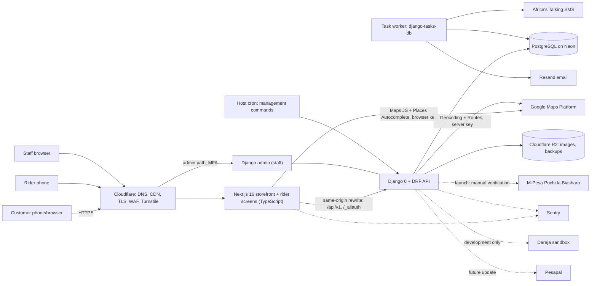

# System Architecture (Current, Approved)

_Status: **Approved baseline, 2026-11-26.** Decision record and full reasoning: `TECHNICAL_ARCHITECTURE_PROPOSAL_2026-11.md`. Decisions: ADR-0001 to ADR-0013. Nothing below is implemented yet._

## 1. Big picture

The browser sees one website. Next.js serves pages and forwards `/api/*` and `/_allauth/*` to Django, so login cookies are first-party and no cross-origin setup is needed. Django owns every business rule, the database and the staff admin ("Django admin is king").

## 2. Responsibilities

| Part | Owns | Must not |
|---|---|---|
| Frontend (Next.js) | Pages, rider screens, calling the API, showing server-calculated prices/stock/status | Calculate authoritative prices, stock or payment status; hold secrets |
| Backend (Django) | Business rules, prices, stock, basket, orders, payments, delivery, auth, admin | Render the storefront |
| Database | Persistent data; only Django connects | Be reached by the browser |
| `shared/contracts/` | Generated OpenAPI contract (drift-checked in CI) | Be hand-edited |
| Worker | SMS/email, payment follow-ups, reconciliation | Hold business rules outside the apps |
| Host cron | Daily/periodic jobs via management commands | — |

**Rule:** the browser is untrusted. Every price, stock check, fee, total and payment status is decided on the server.

## 3. Backend apps (10)

| App | Owns |
|---|---|
| core | Money/phone helpers, idempotency records, error format, base models |
| accounts | Custom user (phone), roles (Customer, Rider, Staff, Admin), addresses, deletion requests, allauth adapter |
| catalogue | Categories, products, sources (farms/suppliers), images, meal kits |
| inventory | Stock levels and stock movements (updated throughout the day) |
| basket | Server basket for every visitor (Django session for guests) |
| orders | Checkout, orders, order lines, status history |
| payments | `PaymentGateway`; `ManualPochiGateway` (launch), Daraja sandbox (development), Pesapal (future) |
| delivery | Zones, fast radius + dispatch point, slots, `GeoService` (Google Geocoding/Routes), delivery partner and rider assignment, delivery status |
| notifications | SMS/email sending and log |
| store | Store settings (incl. payment-timing switch), audit log set-up, reports, admin customisation |

Details: `backend/documentation/architecture/BACKEND_ANALYSIS_2026-11.md` (accepted with amendments).

## 4. Key flows

### Ordering
1. Basket on the server; prices and stock are live and may change during the day.
2. Checkout: phone + one-time code (signs in or creates the account), delivery zone, slot or ETA, address.
3. Payment choice shown only for the options enabled by admin (`allow_pay_now`, `allow_pay_on_delivery`).
4. Server re-prices; if anything changed since the customer saw it → 409 "prices changed". Otherwise stock is reserved in one transaction and the order is created (idempotent).

### Payment at launch (Pochi la Biashara, ADR-0012)
1. Customer (pay now) or rider at the door (pay on delivery) sees the Pochi number, the exact amount and the order reference.
2. Customer pays from their phone and enters the M-Pesa confirmation code (rider can enter it at the door).
3. Payment = `awaiting_verification`. Staff confirm it against the business M-Pesa statement in Django admin → `paid` or `rejected`. Codes are unique; amount must match; every action is audit-logged.
4. Disagreements or doubts → `needs_review`.

### Delivery
Rider/staff actions change `Delivery`; the orders service updates `Order.status` in the same transaction (one status path).

### Stock and prices
Staff adjust stock and prices throughout the day in Django admin; every stock change writes a `StockMovement`; price edits are audit-logged.

## 5. Delivery coverage, maps and delivery partner (ADR-0013)
- **Coverage:** Nairobi County and its immediate neighbouring counties (Kiambu, Kajiado, Machakos).
- **Address:** customer searches with Google Places Autocomplete and confirms a **map pin** (plus estate, building, landmark, instructions). The confirmed pin is stored.
- **Fast vs slots by distance:** pin within `fast_radius_km` (default **42 km**) of the `dispatch_point` (provisional: Nairobi CBD) → **fast**, ETA from Google Routes; else inside the four counties → **slots**; else outside the delivery area. Covers Nairobi and satellite towns such as Ruaka, Rongai, Ngong, Mlolongo, Limuru, Thika. Both values are editable in Django admin.
- **Delivery is done by a delivery partner** (not in-house riders). Partner riders get Rider accounts and use the rider screens; each delivery has an "Open in Google Maps" link with the pin. Partner API integration is a future option once the partner is chosen.

## 6. Security, testing, hosting
- Security architecture: proposal §9 (OWASP-based; allauth phone OTP + Turnstile; staff MFA; same-origin cookies + CSRF; throttles; DB constraints; audit; backups).
- Testing: `docs/testing/TESTING_STRATEGY.md`.
- Hosting: ADR-0007 (free tiers in development; commercial plans in production, Railway Pro preferred; decided in Phase 8).

## 7. Runtime pins
Node.js 24 LTS · Next.js 16 · @vis.gl/react-google-maps · TypeScript · Python 3.13 · Django 6.1 (→ 6.2) · PostgreSQL (Neon) · uv · npm.
