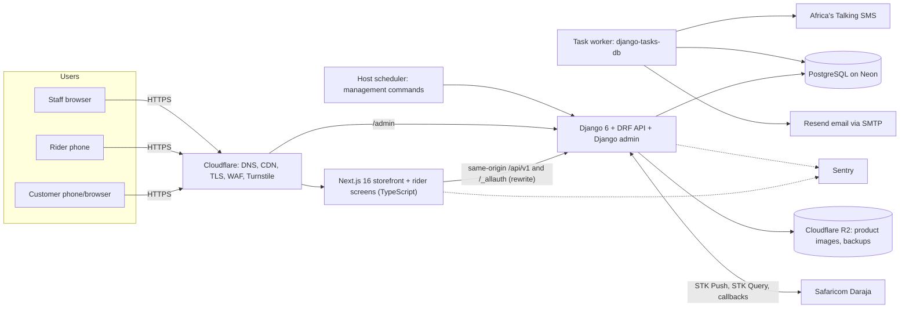

# SokoFresh Technical Architecture Proposal (Consolidated)

_Author: Project Architect · Date: 2026-11-26 · Status: **APPROVED by the owner on 2026-11-26** (all ten items in §17). Recorded as ADR-0005, 0007 (revised), 0010, 0011 and 0012. The current architecture is maintained in `SYSTEM_ARCHITECTURE.md`; this file is the decision record._

## Owner decisions and answers recorded at approval (2026-11-26)

| Topic | Owner decision | Effect on this proposal |
|---|---|---|
| All ten items in §17 | **Approved** | Recorded in ADRs and PROJECT_STATE |
| Daraja | Sandbox only; **not** the production provider | ADR-0012 |
| Future provider | **Pesapal** (M-Pesa, Airtel Money, cards, some banks) as a future update | Own ADR before building |
| Collections at launch | **M-Pesa Pochi la Biashara** | Pochi has no API → manual staff verification in Django admin (ADR-0012); risk R-13 |
| Pay timing (Q3) | **Both**; admin chooses which the customers get and can switch at any time | `allow_pay_now` / `allow_pay_on_delivery` store settings |
| Stock model (Q5) | Updated **throughout the day**; prices also change often (perishable produce) | Continuous stock and price edits in admin; checkout re-prices (409 on change) |
| Delivery coverage (Q4) | **Nairobi County and its immediate neighbouring counties** (Kiambu, Kajiado, Machakos) | Zones configured in admin; fast vs slot per zone set by staff |
| Business (Q1) | **Registered and licensed by the county** | KRA PIN and ODPC position still to confirm |
| Staff tool | "Django admin is king" | Reaffirms ADR-0008 |

Added risk: **R-13** Pochi la Biashara cannot be confirmed automatically, so every payment needs a staff check; fake confirmation messages are a fraud risk. Mitigation: verify against the real M-Pesa statement, unique M-Pesa codes, amount match, audit log; consider a Buy Goods Till or Pesapal when volume grows.

## 0. Purpose, inputs and how to read this

This document brings the frontend and backend research together into **one** technical architecture for SokoFresh. It checks them against each other and against the earlier project documents, removes conflicts and duplication, and asks the owner for one consolidated decision.

**Inputs reviewed (read in full on 2026-11-26):**

| Document | Status before this review |
|---|---|
| `docs/research/TECHNOLOGY_RESEARCH_2026-11.md` | Research record |
| `docs/requirements/REQUIREMENTS_BASELINE.md` (v0.1) | Draft |
| `docs/architecture/SYSTEM_ARCHITECTURE.md` | Proposed |
| `docs/IMPLEMENTATION_ROADMAP.md` | Proposed |
| `frontend/documentation/architecture/FRONTEND_ANALYSIS_2026-11.md` | Accepted by owner |
| `backend/documentation/architecture/BACKEND_ANALYSIS_2026-11.md` | Proposed |
| ADR-0001 to ADR-0009 | 0001–0004, 0008, 0009 Accepted; 0006 Accepted with modifications; 0005, 0007 Proposed |
| `docs/business-requirements/PRODUCT_CATEGORIES.md` | Working list |
| `PROJECT_STATE/00`–`05` | Current |

**Filesystem check:** no application code, package manifest, lockfile or test exists. The design PDF and Figma file are in `assets/design-references/` (KI-002 resolved). The folder is not yet a git repository. (Fact)

**Labels used:**
- **Reconfirm**: the owner already accepted this earlier today; this review found no reason to change it.
- **Change**: this review recommends changing an accepted decision.
- **New**: a decision not yet made.
- **Verify**: a fact to confirm at install/implementation time.

**About earlier approvals:** several ADRs were marked Accepted earlier today, before the backend analysis existed. This proposal treats the **whole architecture** as open for one final review, as the owner requested. Earlier approvals are shown as "Reconfirm". Nothing is recorded as final until the owner answers §17.

---

## 1. Recommended architecture at a glance

**In one paragraph:** a Next.js storefront (TypeScript) and a Django + DRF API are deployed as two separate applications. Browsers see them as **one website**, because Next.js forwards `/api/...` and `/_allauth/...` to Django. That keeps login cookies first-party and avoids cross-origin problems. Django owns every business rule, the PostgreSQL database and the staff admin. A background worker sends SMS and email and re-checks M-Pesa payments. A host scheduler runs the daily jobs. Cloudflare sits in front for DNS, caching, TLS and basic protection.

---

## 2. Conflicts, duplication and unnecessary tools found

This is the most important section of the review. Each item says what clashed, what is recommended, and why.

### 2.1 Conflicting or inconsistent recommendations

| # | Conflict | Recommendation | Reason |
|---|---|---|---|
| C-1 | ADR-0001 includes **Zustand** "for the basket", but the owner later decided the basket lives **on the server** (D-015). The frontend analysis still says "cart (Zustand store + sync)" (§3.11) and "Zustand store, persistence" (§10 step 5) | **Change:** remove Zustand. The server basket is fetched and changed through TanStack Query; small UI state (panel open, step) uses React state; filters live in the URL | Two sources of basket truth would drift. Removes a dependency |
| C-2 | Guest basket identity: frontend proposed "an HttpOnly cookie set by the backend"; backend proposed "the Django session" | **New:** use the Django session (one cookie, also used by allauth). The two proposals are compatible; this picks one | One cookie, already secured, survives sign-in |
| C-3 | Checkout access: frontend route table says checkout needs a signed-in customer ("guest later"); the requirements list guest checkout with phone verification as S; basket is for everyone | **New:** at launch, checkout asks for the phone number and a one-time code (allauth "login by code"), which creates or signs in the account in one step. This **merges FR-25 (guest checkout) into FR-40** | The phone must be verified for M-Pesa anyway; one flow, not two |
| C-4 | Order status vs delivery status: the backend model has `Order.status` (packed, out_for_delivery, delivered…) **and** `Delivery.status` (assigned, out_for_delivery, arrived, delivered…). Two fields can disagree | **Change to backend model:** rider/staff actions change only `Delivery`. The orders service updates `Order.status` in the same database transaction, through one function. Tests assert they always agree | Avoids "delivered" in one place and "out for delivery" in another |
| C-5 | Payment status list (backend §2.2) has no **manual review** state, but backend §5.3 says disagreements between callback and STK Query go to manual review | **Change:** add `needs_review` to Payment status; staff resolve it in Django admin; never auto-marked paid | Makes the stated safety rule possible |
| C-6 | `SYSTEM_ARCHITECTURE.md` lists 13 modules and the Phase 1 layer folders (`domain/`, `application/`, `services/`, `repositories/`); the backend proposes **10 Django apps** with no top-level layers | **Change (when approved):** adopt the 10 apps. Update `SYSTEM_ARCHITECTURE.md`; restructure folders at the Phase 3 scaffold | One structure, matching how Django works |
| C-7 | ADR-0004 says **OpenAPI 3.1**. drf-spectacular's default output is OpenAPI 3.0.3 (Verify; 3.1 support was experimental) | **Change:** accept whatever version drf-spectacular produces reliably (3.0.3 or 3.1). openapi-typescript and Schemathesis accept both (Verify) | The version number does not matter; a reliable generated contract does |
| C-8 | Frontend analysis §0/§4 still says design tokens can't be extracted (PDF missing). The PDF is now present | **Update doc:** token extraction is unblocked (first Phase 3 frontend task) | Stale text |
| C-9 | PROJECT_STATE inconsistencies: KI-002 row says "has **not** been copied" yet is marked Resolved; `03_PENDING_WORK` opens with "Phase 2 is not authorised"; `05_DOCUMENT_INDEX` heading says ADRs are "all Proposed"; `01_CURRENT_STATE` repeats a "not implemented" bullet | **Fix** when recording decisions | Continuity records must be accurate |
| C-10 | One-time login codes sent "through background tasks" (backend §6). If the worker is slow or down, nobody can sign in | **New:** send login-code SMS **directly** (short timeout, rate limited); send order/delivery messages through the worker | Login must not depend on the queue |
| C-11 | Background work and scheduled jobs are designed (STK re-checks, basket expiry, reconciliation, backups) but **no scheduler** and **no worker hosting** were chosen. Render's free tier cannot run background workers | **New:** use the hosting platform's cron feature to run Django management commands; worker runs as its own small service (§10) | Gap: designed jobs had nowhere to run |
| C-12 | ADR-0007 assumed Vercel Hobby for development and left production open. Railway's $5 Hobby plan is positioned for personal projects; its forum answers point commercial apps to Pro | **Change:** production must run on plans that allow commercial use (§10, §11) | Licence compliance |

### 2.2 Duplicated functionality

| Duplication | Recommendation |
|---|---|
| Kenyan phone validation in both apps (Zod on frontend, `phonenumbers` on backend) | **Keep both** (frontend = instant feedback, backend = authority) but share one test list: `shared/test-fixtures/phone-numbers.json`, used by both test suites so they can't disagree |
| Audit history: `django-auditlog` and the domain history tables (`StockMovement`, `OrderStatusEvent`, `PaymentEvent`) | Use auditlog **only** for staff edits in admin (products, prices, zones, settings, users). Do **not** register the history tables with auditlog, so nothing is logged twice |
| Two HTTP libraries implied: `httpx` for Daraja plus the Africa's Talking SDK (its own client) plus `responses` *or* `respx` for mocking | **One HTTP client:** call Africa's Talking's REST API with `httpx` (no SDK), mock all outbound calls with `respx` only |
| Error-format handling: a library (`drf-standardized-errors`) *or* a custom handler | Try the library at scaffold (Verify it can emit RFC 9457). If it needs heavy customisation, use a ~50-line custom handler. **Not both** |
| `django-environ` *or* plain `os.environ` | `django-environ` only (also parses the database URL) |
| Testing strategy in three places (outline, frontend §6, backend §7) | One consolidated `docs/testing/TESTING_STRATEGY.md` after approval (§9), linking to the app-specific sections |
| Two end-to-end folders (`frontend/tests/e2e`, `tests/end-to-end`) | Keep both with clear roles: frontend e2e runs against **mocks** (MSW); root e2e runs against the **real** frontend + backend + test database |
| Module list in `SYSTEM_ARCHITECTURE.md` vs backend analysis | Backend analysis becomes the authority for modules; architecture doc links to it |

### 2.3 Unnecessary tools (removed or deferred)

| Tool | Decision | Why |
|---|---|---|
| Zustand | **Remove** | Server basket (C-1) |
| Africa's Talking Python SDK | **Remove**; use REST via httpx | One HTTP client, simpler mocking |
| `responses` (mock library) | **Remove**; use respx | Matches httpx |
| Redis / Celery | **Not adopted** | django-tasks-db uses PostgreSQL; no extra service to run or pay for |
| Separate search service (Algolia/Meilisearch) | **Not adopted** | PostgreSQL full-text + trigram is enough at this size |
| Storybook, i18n library, analytics | **Deferred** (as ADR-0009) | Not needed for launch |
| Hosted visual-regression service | **Deferred** | Playwright screenshots are free |
| Paid map / geocoding API | **Deferred** (superseded 2026-11-26 by ADR-0013: Google Maps Platform adopted at the owner's request) | Delivery zones are a list, not a map, at launch |
| Email at launch | **Keep but minimal**: receipts only when the customer gives an email; staff alerts | SMS is the primary channel |

### 2.4 Reuse opportunities added by this review

| Need | Reuse | Cost |
|---|---|---|
| Stop bots from triggering paid SMS ("SMS pumping" fraud on login codes) | **Cloudflare Turnstile** (free, privacy-friendly challenge) on the "send code" step, plus per-phone and per-IP limits | Free (Verify current terms) |
| Receive Daraja sandbox callbacks on a laptop | **Cloudflare Tunnel** (`cloudflared`) gives a temporary public HTTPS URL | Free |
| Staff screens | Django admin (already accepted) | Free |
| Sign-in, codes, MFA, rate limits | django-allauth (Proposed ADR-0005) | Free; we write a small adapter (§5) |
| CI database for real-PostgreSQL tests | GitHub Actions PostgreSQL service container | Free allowance |
| Self-hostable Next.js | Next.js `standalone` output; no Vercel-only features | Keeps the exit open |

---

## 3. Frontend technology stack

| Area | Recommendation | Status | Alternatives considered |
|---|---|---|---|
| Framework | Next.js 16 (App Router), React | Reconfirm (ADR-0001) | React + Vite SPA (weaker SEO and first load); SvelteKit/Nuxt (smaller ecosystems) |
| Language | TypeScript | Reconfirm (D-010) | Plain JavaScript |
| Styling / components | Tailwind CSS; shadcn/ui on Radix | Reconfirm | MUI/Chakra (heavier, harder to match the design) |
| Server data | TanStack Query (basket, orders, payment status polling) | Reconfirm | SWR |
| Client state | **React state + URL only (Zustand removed)** | **Change** (C-1) | Zustand, Redux |
| Forms | React Hook Form + Zod | Reconfirm | Formik |
| API client | openapi-fetch, typed from the generated contract | Reconfirm (ADR-0009) | Generated SDKs (more code to maintain) |
| Mocks | MSW, labelled, never in production builds | Reconfirm | json-server |
| Icons, toasts, fonts, images | Lucide, Sonner, next/font, next/image | Reconfirm | — |
| Tests | Vitest, React Testing Library, Playwright (+ screenshots), axe-core | Reconfirm | Jest, Cypress |
| Package manager / runtime | npm; **Node.js 24 LTS** (Next 16 needs Node 20.9+) | New (runtime pin) | pnpm |

**Rendering rule:** public pages (home, shop, product, meal kits) are server-rendered with short caching and fetch the public catalogue on the server. Anything personal (basket, account, orders, rider) is fetched **in the browser** through the same-origin `/api` path, carrying the session cookie. This keeps cached pages free of personal data.

**Folder change at scaffold (KI-003):** remove `src/pages/` and `src/routes/` (App Router replaces both); add `src/components/ui/` and `src/components/rider/`.

---

## 4. Backend technology stack

| Area | Recommendation | Status | Alternatives |
|---|---|---|---|
| Language/runtime | **Python 3.13** (Django 6.1 supports 3.12–3.14) | New (pin) | 3.12 |
| Framework | Django 6.x: start on **6.1**, move to **6.2** when released (expected to be the last LTS-style release before annual "Django 2028") (Verify dates) | Reconfirm (ADR-0002) | Node.js + NestJS |
| API | Django REST Framework + drf-spectacular | Reconfirm | Django Ninja |
| Structure | **10 Django apps**: core, accounts, catalogue, inventory, basket, orders, payments, delivery, notifications, store | New (backend §1.2, C-6) | 16 apps; layered folders |
| Background jobs | Django Tasks API + **django-tasks-db** worker (no Redis) | Reconfirm | Celery + Redis |
| Scheduled jobs | Host cron → Django management commands (STK re-check sweep, basket expiry, reconciliation report, backup) | **New** (C-11) | Celery beat (needs Redis) |
| Supporting libraries (ADR-0010) | django-allauth[headless], phonenumbers, django-filter, httpx, django-environ, django-storages (S3/R2), django-auditlog, drf-standardized-errors *or* custom handler, sentry-sdk, factory_boy, respx, time-machine, pip-audit | New (backend §6, trimmed per §2.2–2.3) | See backend §6 |
| Build ourselves (justified) | Thin Daraja client, idempotency records, stock reservation, basket quote, slot availability | New (backend §4.4, §5.4) | Third-party Daraja packages (single maintainers, Django 6 support unclear) |
| Python packaging | **uv** with a lockfile (one tool for Python version, virtual environment and locked dependencies) | New | pip + pip-tools |

---

## 5. Database architecture

| Item | Recommendation | Status |
|---|---|---|
| Engine | PostgreSQL (version offered by Neon at setup, 17 or 18) | Reconfirm (ADR-0003) |
| Access | Django ORM and migrations; migrations committed and never edited after shared use | Reconfirm |
| Model | Backend analysis §2 domain model, with changes C-4 (single status path) and C-5 (`needs_review`) | New |
| Money | **Whole shillings in integer columns** (`price_kes`) | New |
| Time | UTC stored; Africa/Nairobi for display and cut-offs | New |
| Integrity | Database CHECK/UNIQUE constraints from backend §3.2 as a safety net (no negative stock, one paid payment per order, no double callback) | New |
| Concurrency | Stock reserved at order placement inside one transaction with row locks taken in product-id order | New |
| Search | PostgreSQL full-text + `pg_trgm` for both English and Swahili names (Verify `pg_trgm` is enabled on Neon) | Reconfirm |
| Hosting | Neon: Free plan for development/CI branches; **paid Launch plan for staging-with-real-data and production** | Reconfirm, refined |
| Backups | Neon point-in-time restore (paid) **plus** a nightly encrypted `pg_dump` to Cloudflare R2; a restore test before launch and quarterly | New |
| Retention | Backend §3.5 (7 years for orders/payments, anonymisation on deletion within 30 days, 30-day basket expiry); **confirm with an accountant/lawyer** | New |

**Why the production database cannot stay on Neon Free:** Neon Free gives 100 compute-hours per project per month. A small always-on database at 0.25 compute units needs about 0.25 × 720 h = 180 compute-hours a month, which is over the limit. Neon's free plan also suspends compute when a monthly limit is hit. Production therefore needs the Launch plan (about US$19/month if the smallest size never sleeps, less if it scales down at night; storage is cents).

---

## 6. API and integration architecture

**Contract-first flow:**
1. Backend writes DRF serializers and views.
2. drf-spectacular generates the OpenAPI file, committed to `shared/contracts/openapi.yaml`.
3. CI fails if the committed file differs from a fresh generation (**drift check**).
4. Frontend generates TypeScript types from the file (openapi-typescript) and calls the API with openapi-fetch. Contract changes become type errors.
5. Schemathesis tests the running API against the file in CI.
6. While an endpoint is not yet built, the frontend uses MSW mocks typed from the same file.

**Conventions (backend §4.1, agreed by both analyses):** `/api/v1/`; JSON with snake_case; slugs for public items, unguessable references for orders, never sequential IDs; page-number pagination (`page`, `page_size` ≤ 100); RFC 9457 problem-details errors with field errors; integer KES; `Idempotency-Key` on order creation and payment requests; versioned breaking changes need Architect approval.

**Same-origin routing (New):** the browser talks only to `www.sokofresh.co.ke`. Next.js rewrites `/api/*` and `/_allauth/*` to the Django service. Benefits: first-party `SameSite=Lax` cookies; no CORS configuration; one domain for CSP. Staff reach Django admin at a non-obvious path on the API host, protected by MFA. Fallback if the host makes rewrites awkward: `api.sokofresh.co.ke` plus `django-cors-headers` with credentials and `CSRF_TRUSTED_ORIGINS`.

**External integrations, each behind one adapter in one module:**

| Integration | Module | Adapter | Test double |
|---|---|---|---|
| Safaricom Daraja | payments | `PaymentGateway` → `DarajaGateway` | `FakeGateway` + recorded sandbox responses |
| Africa's Talking SMS | notifications (+ allauth adapter for codes) | `SmsSender` | respx mocks; AT sandbox |
| Resend email | notifications | Django SMTP backend | Django's in-memory email backend |
| Cloudflare R2 | catalogue (images), store (backups) | django-storages | Local file storage |
| Sentry | both apps | SDK with personal-data scrubbing | Disabled in tests |

**API inventory:** backend analysis §4.2 is adopted as the starting contract, with the basket details from §4.3 and changes C-3/C-4/C-5. Frontend §8 needs are all covered (store settings, categories, products, meal kits, zones with fast/slot mode, basket quote, orders, payment status, rider actions, auth).

---

## 7. Authentication and authorization

**Recommendation (ADR-0005, still Proposed; reconfirmed by this review):** django-allauth in headless mode.

| Topic | Design |
|---|---|
| Customer sign-in | Phone number + one-time SMS code ("login by code"); no password needed |
| What we must build | allauth does not store phone numbers itself: the custom User model holds the phone, and our account adapter implements the phone storage hooks and `send_verification_code_sms` (calls Africa's Talking) |
| Abuse protection | allauth rate limits; per-phone and per-IP limits; **Cloudflare Turnstile** on "send code"; alert on unusual SMS volume |
| Sessions | Django session cookie: HttpOnly, Secure, SameSite=Lax; CSRF token on every change (allauth browser client flow) |
| Roles | Django groups: Customer, Rider, Staff, Admin. Riders use the Next.js rider screens; Staff/Admin use Django admin |
| Staff accounts | MFA (TOTP) required; admin login protected with allauth's `secure_admin_login`; non-default admin URL |
| Object-level checks | Customers see only their own orders/addresses (404 for others' references); riders see only assigned deliveries |
| Custom user model | Created **before the first migration** (cannot be changed easily later) |

**Alternatives:** hosted auth (Clerk/Auth0: monthly cost, data outside our control, still needs SMS); build our own (highest risk).

---

## 8. Payments and M-Pesa

**Status:** ADR-0006, accepted with modifications: build behind `PaymentGateway`, develop on the Daraja sandbox, choose the production provider before go-live. This review **reconfirms** it and adopts the backend analysis §5 controls.

**Controls (all become tests):**
1. Amount always taken from the order on the server, never from the request.
2. A Payment row is created before calling Daraja; one row per STK attempt; at most one `paid` per order (database rule).
3. Callback URL contains a long, rotatable secret; raw payload stored first; reply quickly; process in the worker.
4. Callback is matched on `CheckoutRequestID`, amount and account reference, then **confirmed with an STK Query** before marking paid.
5. Callback/query disagreement → `needs_review` (C-5), resolved by staff.
6. No callback in about 2 minutes → worker polls STK Query with backoff.
7. Idempotent processing; unique `checkout_request_id` and `provider_receipt`.
8. Daily reconciliation report; secrets only in environment variables; Daraja OAuth token cached.
9. Endpoint paths in configuration; confirm on developer.safaricom.co.ke at implementation (Daraja 3.0).

**Pay timing is still a business decision** (requirements Q3). The model supports pay-now and pay-on-delivery; launch can enable either or both.

**Production provider options (decide before Phase 9):**

| Option | Cost | Needs |
|---|---|---|
| Daraja direct | No aggregator fee; Safaricom merchant tariffs apply (Verify) | Registered business, KRA PIN, Till/Paybill, Daraja go-live |
| Paystack Kenya | 1.5% per M-Pesa payment; cards 2.9% | Paystack business onboarding |

---

## 9. Security architecture

Guided by OWASP Top 10, OWASP API Security Top 10 and ASVS, and the Kenya Data Protection Act, 2019.

| Layer | Control | Where |
|---|---|---|
| Edge | Cloudflare TLS, DNS, caching, free WAF rules, rate rules on `/_allauth` and `/api/v1/orders`; Turnstile on code requests | Cloudflare |
| Browser | React output escaping; no `dangerouslySetInnerHTML` on API text; security headers; **Content Security Policy** (see risk R-9 about Next.js nonces vs caching) | Next.js |
| Session / CSRF | First-party session cookie, SameSite=Lax, CSRF header on writes | Django + allauth |
| Authentication | Phone OTP; staff MFA; admin login hardening | allauth |
| Authorization | Role groups + DRF permissions + object-level checks; 404 for others' objects | Django |
| Input validation | DRF serializers (authoritative); Zod for user feedback; DB constraints as last line | Both + DB |
| Injection / SSRF | ORM parameterisation; outbound calls only to fixed, configured hosts | Django |
| Abuse | DRF throttles (stricter on codes, orders, payments); basket size limits | Django |
| Payments | §8 controls | payments app |
| File uploads | Staff-only product images; type/size checked; stored and served from R2, never executed | Django admin + R2 |
| Secrets | Host environment variables / secret store; `.env` git-ignored; secret scanning in CI (e.g. gitleaks); rotation plan for Daraja and AT keys | CI + hosts |
| Dependencies | Dependabot; `pip-audit` and `npm audit` in CI; versions pinned in lockfiles | CI |
| Data protection | TLS everywhere; data minimisation; retention and anonymisation (§5); no full phone numbers or tokens in logs; Sentry scrubbing | Both |
| Audit | auditlog for staff edits; domain history tables; payment event log | Django |
| Backup / recovery | Neon PITR + nightly encrypted dump to R2; restore tests | Ops |
| Compliance | ODPC registration position confirmed before launch (legal advice) | Owner |

**Security testing:** CSRF/IDOR/throttle tests in the API suite; payment abuse cases; Django `check --deploy`; an OWASP ZAP baseline scan against staging in Phase 8 (free tool).

---

## 10. Testing strategy (consolidated)

| Level | Frontend | Backend | Whole product (`tests/`) |
|---|---|---|---|
| Unit | Vitest: formatting, phone normaliser, hooks | pytest: fees, thresholds, kit pricing, cut-offs, status transitions | — |
| Component | React Testing Library + axe | — | — |
| Integration | MSW-backed page tests | pytest-django on **real PostgreSQL**: stock reservation, constraints, **race for the last item**, basket merge | — |
| API / contract | Type-check against generated types | API tests per endpoint (200/401/403/404/422/409); Schemathesis; OpenAPI drift check | — |
| End-to-end | Playwright vs mocks | — | Playwright vs real stack: browse → basket → sign-in → checkout → sandbox payment → tracking |
| Payments | Payment status UI states | Recorded sandbox cases: success, cancel, timeout, duplicate/late/mismatched callback, query disagreement | Sandbox run in staging |
| Accessibility | axe in component + e2e; manual TalkBack/VoiceOver, keyboard, 200% zoom before launch | — | — |
| Visual regression | Playwright screenshots, baselines generated **in CI only** (screenshots differ between Windows and Linux) | — | — |
| Security | Header checks | CSRF, IDOR, throttling, secrets-not-logged | ZAP baseline on staging |
| Performance | LCP/INP/CLS budgets measured on staging + one real mid-range Android | API p95 < 500 ms on realistic data | Light load test of evening peak (tool chosen in Phase 8, e.g. k6) |
| Shared fixtures | `shared/test-fixtures/` (phone numbers, sample catalogue) used by both | | |

**CI on every push (GitHub Actions):** lint + type-check + unit/component tests (frontend); lint + pytest with a PostgreSQL service container (backend); OpenAPI drift check; Schemathesis; dependency and secret scans. End-to-end against the real stack runs on the main branch and before releases.

Rule kept from the project instructions: no fake tests; nothing reported as passed unless executed.

---

## 11. Hosting, infrastructure and deployment

**Principles:** commercial-use-allowed plans in production; all services in the **same region** (Europe, nearest common option to Kenya) to keep the Next.js → Django → database hops short; Cloudflare CDN for static files and images; no Vercel-only features so Next.js can move hosts.

| Environment | Recommendation |
|---|---|
| Local (Windows) | Node 24 + Python 3.13 (uv) installed natively; database = a Neon development branch (no local PostgreSQL install needed), or local PostgreSQL later; Cloudflare Tunnel for Daraja sandbox callbacks |
| CI | GitHub Actions with a PostgreSQL service container |
| Staging (from Phase 8) | Same platform and region as production, smallest sizes, Daraja/AT sandboxes, seeded fake data |
| Production | One of the two options below |

**Production hosting options (decide in Phase 8 after measuring staging; budget now):**

| | Option A (recommended, simplest) | Option B |
|---|---|---|
| Frontend | Railway **Pro** service (Next.js standalone) | Vercel **Pro** ($20/month incl. $20 usage credit, 1 seat) |
| Backend web + worker + cron | Railway Pro services (same project, private networking) | Render: web Starter ~$7 + worker Starter ~$7 + cron (billed per minute, $1 minimum) |
| Database | Neon Launch | Neon Launch |
| Why choose | One platform, one bill, private network between frontend and API, commercial use clearly on Pro | Best-in-class Next.js hosting and image optimisation |
| Watch out | Railway Pro is $20/month and includes $20 of usage; above that, metered. Next.js image optimisation runs on our own CPU | Two hosting vendors plus Neon; cross-provider hop for every API call |

Cloudflare (DNS, CDN, TLS, Turnstile, R2), Sentry, Resend and GitHub stay the same in both options.

**Deployment flow:** push to GitHub → CI → on `main`, automatic deploy to staging → manual promotion to production. Database migrations run as a release step before the new web version starts. Rollback = redeploy the previous version (migrations written to be backward-compatible for one release).

---

## 12. Estimated costs and free-tier limits

**Development (Phases 3–7): about US$0/month.**

| Service | Free tier used | Limitation to watch |
|---|---|---|
| Neon Free | 1 GB storage and 100 compute-hours per project; scales to zero after 5 min | Fine for dev/CI; not for production (§5) |
| Cloudflare R2 | 10 GB-month storage, 1M writes, 10M reads; no egress fees | Only Standard storage is free |
| Sentry Developer | 1 user, 5,000 errors/month | One user only |
| Resend Free | 3,000 emails/month, max 100/day | Daily cap |
| Africa's Talking | Sandbox free | Live SMS is paid |
| Daraja | Sandbox free | Production needs registered business |
| GitHub + Actions | Private repo with a free minutes allowance (Verify current allowance) | Minutes cap |
| Vercel Hobby (only if used for previews) | Free | **Non-commercial only** |

**Production (estimate, not a quote; confirm in Phase 8):**

| Item | Option A (Railway) | Option B (Vercel + Render) |
|---|---|---|
| App hosting | $20 Railway Pro (includes $20 usage) + overage ~$0–15 | $20 Vercel Pro + ~$15 Render (web + worker + cron) |
| Database (Neon Launch) | ~$10–20 | ~$10–20 |
| Cloudflare, R2, Sentry, Resend | $0 at launch volumes | $0 |
| **Monthly total** | **≈ US$30–55** | **≈ US$45–55** |
| SMS | Usage: third-party comparisons put Kenyan SMS around KES 0.4–0.8 each (**Verify on Africa's Talking's own pricing page**); every login code and order update is one message | same |
| One-time | Sender ID ≈ KES 7,500 + VAT (secondary source; Verify); domain `.co.ke` (Verify price) | same |
| Payments | Daraja: Safaricom merchant tariff (Verify). Paystack: 1.5% per M-Pesa payment | same |

## 13. Vendor lock-in assessment

| Component | Lock-in | Exit route |
|---|---|---|
| Next.js / React | Low (open source) | Self-host with `standalone` output; avoid host-only features |
| Django / DRF / allauth / PostgreSQL | None (open source) | — |
| Neon | Low | Standard PostgreSQL; nightly `pg_dump` we hold in R2 |
| Railway / Render / Vercel | Low–medium | Standard containers/build commands; config kept in repo |
| Cloudflare R2 | Low | S3-compatible API; copy bucket to any S3 store |
| Cloudflare DNS/CDN/Turnstile | Low–medium | DNS export; Turnstile behind one form component |
| Sentry | Low | SDK works with self-hosted Sentry/GlitchTip |
| Resend | Low | Standard SMTP |
| Africa's Talking | Low | `SmsSender` adapter; other Kenyan SMS providers exist |
| Safaricom Daraja / M-Pesa | Unavoidable for the Kenyan market | `PaymentGateway` allows adding Paystack or others |
| GitHub Actions | Medium | Workflows are YAML; tests are runnable locally |

---

## 14. Compatibility check

| Pair / chain | Status | Note |
|---|---|---|
| Next.js 16 ↔ Node 24 LTS | Compatible | Next 16 needs Node ≥ 20.9 |
| Next.js 16 ↔ React 19.x ↔ shadcn/ui, TanStack Query, RHF, Zod | Compatible (Verify versions at scaffold) | — |
| Django 6.1 ↔ Python 3.13 | Compatible | 6.1 supports 3.12–3.14 |
| Django 6.x ↔ DRF, drf-spectacular, django-allauth, django-tasks-db, django-auditlog, django-filter, django-storages, drf-standardized-errors | **Verify each** declares Django 6 support at install | Fallbacks: custom error handler; django-simple-history for audit |
| drf-spectacular ↔ openapi-typescript ↔ openapi-fetch ↔ Schemathesis ↔ MSW | Compatible in principle; OpenAPI version per C-7 | Drift check in CI |
| allauth headless ↔ DRF | Compatible | allauth ships DRF authentication helpers |
| allauth phone login ↔ Africa's Talking | Compatible via our adapter | We implement phone storage + SMS hook |
| Session cookies ↔ Next.js rewrites ↔ Django CSRF | Compatible when same-origin | Fallback: subdomain + CORS (§6) |
| django-tasks-db ↔ Neon | Compatible | Worker polls the database; keep poll interval modest so Neon can scale down at quiet times (Verify setting) |
| Neon ↔ `pg_trgm` | Verify extension availability | Fallback: full-text only |
| Next.js `next/image` ↔ R2 images | Compatible (`remotePatterns`) | Optimisation cost depends on host (§11) |
| Windows development ↔ all tools | Compatible natively; Playwright screenshot baselines must come from CI | WSL optional |
| Daraja callbacks ↔ local dev | Compatible via Cloudflare Tunnel | — |

**Conclusion:** no blocking incompatibility found. The "Verify" items are routine install-time checks with named fallbacks.

---

## 15. Major risks and dependencies

| # | Risk / dependency | Impact | Mitigation | Owner |
|---|---|---|---|---|
| R-1 | Business not registered → no Daraja production, no SMS sender ID, ODPC position unclear | Blocks launch, not development | Start registration now; build on sandboxes | Owner |
| R-2 | Pay timing, stock model, launch zones undecided (requirements Q3–Q5) | Rework in orders/delivery | Model supports all options; decide before Phase 6 | Owner |
| R-3 | One developer learning Python and TypeScript at the same time | Slower progress, mistakes | Vertical slices; generated contracts; strong tests; small steps | Architect |
| R-4 | Daraja sandbox unreliability (reported query/callback disagreement; single unverified source) | Flaky payment testing | `needs_review` state; recorded responses for automated tests | Backend |
| R-5 | Django 6 support gaps in third-party packages | Delays at scaffold | Verify at install; fallbacks named (§14) | Backend |
| R-6 | Next.js monthly security releases | Exposure if not updated | Dependabot + monthly update routine | Frontend |
| R-7 | SMS pumping fraud on login codes | Unexpected SMS bills | Turnstile, rate limits, spend alerts | Backend |
| R-8 | Hosting outside Kenya → latency | Slower pages | Same-region services; CDN; measure on staging | Architect |
| R-9 | Content Security Policy with nonces makes Next.js pages dynamic (no static caching) | Performance vs security trade-off | Decide in a Phase 3 security spike: start with a strict non-nonce policy for cached pages if feasible | Frontend + Architect |
| R-10 | Free tiers change | Surprise costs | Re-check prices before Phase 8; spend alerts on all paid services | Architect |
| R-11 | Placeholder content (testimonial, contacts) shipped by mistake | Trust/legal | Launch checklist items (D-016, D-7) | Frontend |
| R-12 | Legal/tax retention periods unconfirmed | Compliance | Accountant/lawyer confirmation before launch | Owner |

---

## 16. Phased implementation roadmap (revised)

Each phase ends with tests actually run, PROJECT_STATE updated and an owner check. **Nothing starts without approval.** Frontend and backend work in parallel inside each phase, joined by the contract.

| Phase | Goal | Frontend | Backend | Exit criteria |
|---|---|---|---|---|
| 2 (now) | Approve architecture | — | — | §17 answered; ADRs recorded |
| 3 Foundations | Working empty apps + pipelines | Scaffold Next.js (KI-003 fix), tokens from PDF, shadcn init, MSW, test runners | uv project, 10 apps, **custom user model**, settings, Neon dev branch, drf-spectacular → `shared/contracts`, pytest | git + GitHub; CI green on both apps; drift check working |
| 4 Catalogue slice | Real storefront data | Header, home, shop, search, meal-kit display, zone picker (display) | catalogue, inventory, store, delivery-zone read API; Django admin for staff; seed data | Home/shop show seeded data from the real API at 360/768/1280 px; axe clean |
| 5 Accounts & basket | Sign-in and server basket | Sign-in (phone + code), basket UI, free-delivery progress | allauth adapter + AT sandbox + Turnstile; basket API + merge | Basket survives sign-in; throttles tested |
| 6 Checkout & orders | Place orders safely | Checkout steps, confirmation, tracking | orders, slots/ETA, idempotency, stock reservation | Race-for-last-item test passes; 409 on price change |
| 7 Payments, rider, notifications | Daraja sandbox end to end | Payment status UI, rider screens | payments app with all §8 controls; rider API; notifications worker; cron jobs | Full purchase on sandbox incl. failure cases |
| 8 Hardening & staging | Production-like environment | Visual baselines, accessibility manual pass, performance on a real phone | ZAP scan, load test, backup/restore test | Staging live; choose production host (§11) |
| 9 Go-live | Launch | Remove placeholders | Production provider decision (ADR-0006), Daraja go-live, sender ID, ODPC | Launch checklist complete |
| 10 After launch | Improve | Swahili UI, reviews, saved addresses polish | WhatsApp, live tracking, custom admin if needed | — |

**Owner actions now (long lead time):** business registration and KRA PIN; Till or Paybill; launch zones (fast vs slots); pay timing; stock model; accountant/lawyer on retention and ODPC.

---

## 17. Decisions requested from the owner

Approving this proposal would record the following. You can approve all, or name items to change.

1. **Reconfirm** the core stack: Next.js 16 + React + TypeScript; Django 6.x + DRF; PostgreSQL; REST + generated OpenAPI; Django admin for staff (ADR-0001–0004, 0008, 0009).
2. **Change** ADR-0001/0009: remove Zustand (C-1).
3. **Accept** ADR-0005: django-allauth headless with phone + code sign-in, our adapter, Turnstile, staff MFA; checkout uses the same phone sign-in (C-3).
4. **Accept** the backend analysis as the backend baseline with changes C-4 and C-5 (domain model, 10 apps, integer KES, API conventions, guest basket via session, own Daraja client and idempotency).
5. **Accept** ADR-0010 backend libraries as trimmed in §4 (no AT SDK, respx only, django-environ only).
6. **Accept** the API/integration architecture in §6, including same-origin routing and the OpenAPI version change (C-7).
7. **Accept** ADR-0007 as revised in §11–12: free tiers for development; production on commercial plans, **Option A (Railway Pro) preferred**, final choice in Phase 8; budget ≈ US$30–55/month plus SMS.
8. **Accept** the consolidated security (§9) and testing (§10) architecture.
9. **Accept** the revised roadmap (§16).
10. **Keep deferred:** production payment provider (before Phase 9); business questions Q1–Q7 in the requirements.

After approval, the Architect will: write/update ADR-0001 (superseding note for Zustand), 0004, 0005, 0007, 0010; update `SYSTEM_ARCHITECTURE.md`, `IMPLEMENTATION_ROADMAP.md`, `TECHNOLOGY_DECISIONS_PENDING.md`, the backend analysis status, the testing strategy; fix the PROJECT_STATE inconsistencies (C-9); and record each decision in `PROJECT_STATE/02_DECISIONS_AND_CHANGES.md`.

---

## Sources (accessed 2026-11-26, additional to the research record)

- Vercel Pro plan ($20/month, 1 seat, $20 usage credit): https://vercel.com/docs/plans/pro-plan
- Railway plans and commercial-use guidance: https://docs.railway.com/pricing/plans , https://station.railway.com/questions/restrictions-for-hobby-plan-4405c75e , https://station.railway.com/questions/small-billing-saas-application-for-retai-8541fe25
- Render pricing (workers have no free tier; cron $1 minimum): https://render.com/articles/how-much-does-cloud-application-hosting-cost-for-small-businesses , https://render.com/pricing
- django-allauth phone support (custom storage and SMS adapter): https://docs.allauth.org/en/dev/account/phone.html , https://docs.allauth.org/en/dev/account/adapter.html
- Neon Free limits and Launch pricing: https://neon.com/faqs/free-plan-limits-and-quotas , https://neon.com/faqs/managed-postgres-databases-free-tier
- All other sources: `docs/research/TECHNOLOGY_RESEARCH_2026-11.md` and the two analysis documents.
