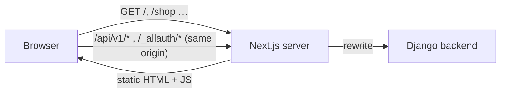

# Frontend Architecture (as implemented)

_Updated 2026-11-27 (Phase 3 foundations). Describes the code that exists. Plans and requirements are in `FRONTEND_ANALYSIS_2026-11.md`; decisions in ADR-0001, 0004, 0009, 0011, 0013._

## 1. How a page reaches the customer

- Pages are **Server Components** rendered at build time where possible (all Phase 3 routes are static; `/shop` is partially prerendered because it reads `?q=`). Only interactive pieces are Client Components.
- **Same-origin API (ADR-0011 item 3).** The browser calls `/api/v1/...` and `/_allauth/...` on the storefront's own address; `next.config.ts` rewrites them to `BACKEND_ORIGIN`. Cookies (HttpOnly session, readable `csrftoken`) stay first-party, so no CORS is needed. Verified: path, query, method, cookies and `X-CSRFToken` reach Django; Django's `Set-Cookie` comes back.
- What Django receives through the rewrite: `Host` = the backend's own host, `Origin` = the browser's origin, `X-Forwarded-Host` = the storefront host. Consequence for the backend (coordination note in `shared/documentation/CONTRACTS.md`): production `ALLOWED_HOSTS` must contain the backend's internal host name and `CSRF_TRUSTED_ORIGINS` the storefront origin.

## 2. Configuration

| Setting | Where | Notes |
|---|---|---|
| `BACKEND_ORIGIN` | server only | Validated origin (scheme + host + port). **Required** for `next build` and `next start` because rewrites are baked into the build; defaults to `http://127.0.0.1:8000` for `next dev` and `next typegen`. `src/config/backend-origin.ts` |
| `NEXT_PUBLIC_SITE_URL` | public | Metadata base; an `https://` value turns on HSTS and `upgrade-insecure-requests` |
| `NEXT_PUBLIC_API_MOCKING` | public | `enabled` starts MSW in `next dev` only; production builds remove the code |
| `NEXT_PUBLIC_SHOW_DESIGN_SYSTEM` | public | `true` exposes `/design-system` in a production build (used only by the e2e build) |

Next.js 16 options kept from `create-next-app`: `cacheComponents`, `partialPrefetching`, Tailwind through `@tailwindcss/turbopack`. Also `poweredByHeader: false`, `reactStrictMode`, `images.qualities: [75]` (required in Next 16), AVIF/WebP, no remote image hosts until the R2 bucket exists.

## 3. API layer (`src/api/`)

| File | Role |
|---|---|
| `schema.d.ts` | Generated from `shared/contracts/openapi.yaml` by openapi-typescript (`npm run api:types`). Never edited by hand; CI fails if stale (`npm run api:check`) |
| `client.ts` | openapi-fetch client typed by `paths`; 15 s timeout; network/timeout errors become `ApiError`; CSRF middleware; `unwrap()` turns results into data or a thrown `ApiError` |
| `errors.ts` | RFC 9457 problem details: runtime shape check, `ApiError` (`status`, `code`, field errors, `Retry-After`), friendly message per code. The message table is typed `Record<ApiErrorCode, string>`, so a new backend code is a compile error until it has wording |
| `csrf.ts` | Reads `csrftoken`, sends `X-CSRFToken` on POST/PUT/PATCH/DELETE, bootstraps the cookie from `/_allauth/browser/v1/config` once if missing (contract F-6) |
| `query-client.ts` | TanStack Query defaults: 30 s stale time; retries only network/timeout/502/503/504, at most twice; mutations never retried |
| `server-client.ts` | `server-only` client that calls Django directly for public data (no cookies forwarded) |
| `queries/health.ts` | `queryOptions` for the only Phase 3 endpoint, `GET /api/v1/health` |

The frontend formats prices but never computes prices, discounts, fees, totals or payment status (architecture §2).

## 4. State

- Server data (catalogue, basket, orders): TanStack Query (`src/app/providers.tsx`, one client per tab).
- Basket: **server-side** for every visitor (D-015); no client store.
- Filters and search: URL (`/shop?q=`), so pages are shareable and work without JavaScript.
- Local UI state: React state.

## 5. Mocks

MSW 3 handlers in `src/mocks/handlers.ts` cover only endpoints that exist in the contract and are typed with its types; every mocked response carries `X-SokoFresh-Mock: true` and the page shows `MockDataBanner`. The browser worker is loaded inside `useEffect` behind inline `process.env` checks, so production builds contain no MSW code (verified: no `setupWorker` in `.next/static`).

## 6. Errors and loading

`app/error.tsx` (route errors; Next 16 passes `error: unknown` and `retry()`), `app/global-error.tsx` (root-layout failures; inline styles), `app/not-found.tsx`, `app/loading.tsx`. Components: `LoadingState`, `EmptyState` (server) and `ErrorState` (client). Customers only ever see wording from `errors.ts`, never server detail.

## 7. Decisions taken during Phase 3 (reversible, within the approved architecture)

| # | Decision | Reason |
|---|---|---|
| P3-F1 | Fonts self-hosted with `next/font/local` (Fontsource Latin variable files, OFL) instead of `next/font/google` | Build does not depend on reaching Google; same self-hosting result required by ADR-0009 |
| P3-F2 | Static CSP in `next.config.ts` with `script-src 'unsafe-inline'`, no nonces (interim) | Nonces force dynamic rendering for every page and disable PPR/CDN caching (Next.js CSP guide), against NFR-01. All other directives strict. Revisit before launch (R-9): experimental SRI or nonces on dynamic routes only |
| P3-F3 | shadcn/ui components written by hand to the shadcn pattern; `components.json` included | The shadcn registry was unreachable from the build environment; `npx shadcn add` works later |
| P3-F4 | TypeScript 5.9 (not 7) | openapi-typescript 7.13 supports TypeScript 5 only |
| P3-F5 | ESLint 9 (not 10) | `eslint-config-next` 16 is built and tested against ESLint 9 |
| P3-F6 | Generated `schema.d.ts` is committed, with a drift check | Type-checking and builds work without running the generator; CI catches staleness |
| P3-F7 | `/design-system` preview route (404 in production builds) | Visual review and real-browser accessibility scan of every foundation component |
| P3-F8 | Footer, announcement bar and basket count show no placeholder data | Contact details, free-delivery threshold, payment timing and basket count come from APIs (Phases 4–5); the design's values are placeholders (D-7) |

## 8. Not built yet (by design)

Catalogue, meal kits, basket, sign-in, checkout, delivery-area picker, address picker (Google Maps, checkout route only, ADR-0013), order tracking, rider screens, visual-regression baselines, Sentry.
